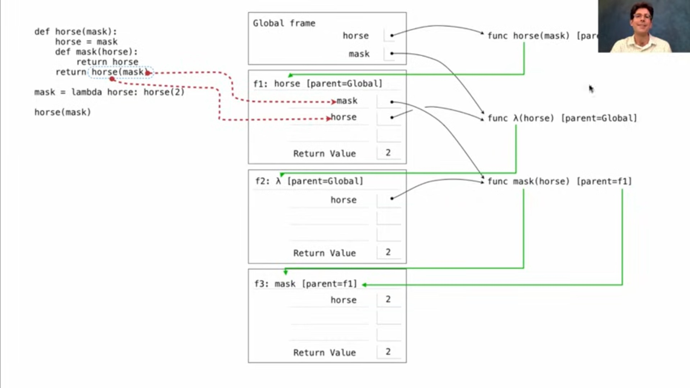

## 1 函数抽象

可见chapter1.md

### Environment 框架图

程序常常做两件事：表达式求值，执行语句

每个帧里存放着一系列的绑定（binding）：名称 → 对应的值

级联环境（Extended Environments）：一个环境可以由任意长的帧链构成，并且总是以全局帧结束。

> 一个函数如何定义？

``` python
def f(*args):
    <suites>
```

def 语句 将 f 绑定名称为函数 f

当调用该函数时：

1. 在一个新的局部帧中，将参数值绑定到函数的形参名上
2. （参考高阶函数部分） Copy the parent of the function to the local frame `[parent=<lable>]`
3. 在以该局部帧为起点的环境中，执行函数体内容

> 高阶函数，情况更复杂

词法作用域（Lexical scope）：局部定义的函数还能访问它们被定义时所在环境中的名字绑定。

内部函数访问的是它被**定义**时的环境，而**不是它被调用**时的环境。

1. 每一个用户定义的函数都有一个父环境：即它被定义时所在的环境（指向环境包含一系列帧的第一个帧）。
2. 当调用一个用户定义的函数时，它创建的局部帧会扩展它的父环境。

父环境的确定：

1. 函数值的父环境即定义该函数时所在环境的第一帧。（同上面括号注释）
2. 如果一个函数没有标注 parent，则说明它定义在全局环境中。
3. 当我们调用一个用户定义的函数时，新创建的帧会继承该函数的 parent 作为自己的父帧。

### 构建抽象

换句话说，函数定义应该能够隐藏细节。
函数的使用者可能并没有亲手编写该函数，而是从另一位程序员那里获得的一个黑盒。
程序员在使用函数时，不应该需要了解其内部实现。

函数抽象的三个要素：要精通函数抽象的使用，考虑其三个核心属性通常大有裨益：

1. 定义域（Domain）：函数可以接受的参数集合
2. 值域（Range）：函数可以返回的值的集合
3. 意图（Intent）：函数在输入与输出之间计算出的关系（以及它可能产生的任何副作用）

换句话说，只需看这三个东西， 不用在乎实现。这就是“抽象”的作用

### lambda 函数

和 def 函数的区别：绑定名称不同。 

``` python
f = lambda x : x * x
def square(x):
    return
"""
f: function lambda(x)
square: function square(x)
"""
```

关于环境：

其父环境对应它被求值所在的帧， `lambda` 函数其实是一个表达式。

### 柯里化 Curryings

多参数转为单参数，返回一个高阶函数，可用于参数之间有关系的情况

```python
from operator import add
def curry2(f):
    def g(x):
        def h(y):
            return f(x, y)
        return h
    return g

m = curry2(add)
adder_3 = m(3)
adder_3(2)
"""
output: 5
"""
def uncurry2(g):
    """返回给定的柯里化函数的双参数版本"""
    def f(x, y):
        return g(x)(y)
    return f
```

### 函数装饰器（不大懂）

```python
>>> def trace(fn):
        def wrapped(x):
            print('-> ', fn, '(', x, ')')
            return fn(x)
        return wrapped

>>> @trace
    def triple(x):
        return 3 * x

>>> triple(12)
->  <function triple at 0x102a39848> ( 12 )
36
```

和下面这种写法等价。 `trace` 的出现改变了函数定义的过程。给函数一个包装。

``` python
>>> def triple(x):
        return 3 * x
>>> triple = trace(triple)
```

专家扩展：`@` 符号后面也可以跟一个调用表达式。`@` 后面的表达式先被求值（就像上面的 trace），

然后执行 `def`，最后把装饰器表达式的结果应用到新定义的函数上，并把最终结果绑定到 `def` 中的名字。

### WWPD

注意： `print(x)` 返回值是 `None` 。

以及 `print("xxxx")` 输出不含引号，但是若查看一个 string 的值，是带引号的。

看函数是否调用（有无括号）。

``` python
def horse(mask):
    horse = mask
    def mask(horse):
        return horse
    return horse(mask)

mask = lambda horse: horse(2)
horse(mask)
// Result: 2
```

这是一道要画图的题。



重点在于 `def mask` 时，将 $mask$ 名称重新绑定。

还有：短路运算符的返回值。

计算 `<left> and <right>`：

1. 计算子表达式 `<left>`
2. 如果结果是假值 v，则整个表达式的值就是 v
3. 否则，表达式的计算结果为子表达式 `<right>` 的值

------

计算 `<left> or <right>`：

1. 计算子表达式  `<left>`
2. 如果结果为真值 v，则表达式的计算结果就是 v
3. 否则，表达式的计算结果为子表达式 `<right>` 的值。

------

计算 `not <exp>`：

1. 计算 `<exp>`，如果结果为假值，则值为 `True`；否则为 `False`

例如：

```
>>> 2 and 1
1
>>> -1 or 5
-1
```

### 递归

迭代属于递归。

环境图：用堆栈理解

看到一个很好笑的词：信仰之跃

>虽然我们可以使用计算模型来展开递归，但**将递归调用视为函数抽象**会更容易理解一点。也就是说，我们不用关心 `fact(n-1)` 在 `fact` 的函数体中是怎么实现的；我们只需要简单地相信它能计算 n-1 的阶乘就好了。将递归调用看作一种函数抽象被称为**递归的信仰之跃**（recursive leap of faith）。我们用函数自身来定义一个函数，但在验证函数的正确性时，我们只需**相信在更简单的情况下，函数同样能正确工作**。

- 互相递归

感觉没什么用。作用在于体现抽象屏障，《封装》。

比如 Alice 和 Bob 玩游戏。

> 一种自然的分解方式是把两种策略分别封装成函数，这样修改其中一种策略不会影响到另一种，保持了**抽象屏障**（abstraction barrier）。为了体现游戏的回合制性质，这两个函数在每一回合结束时互相调用。

### 怎么还有题不会 from disc02

The process function below uses tally and result functions to analyze all adjacent pairs of digits in a non-negative integer n. A tally function is called on each pair of adjacent digits.

``` python
def process(n, tally, result):
    """Process all pairs of adjacent digits in N using functions TALLY and RESULT.
    """ 

    while n >= 10:
        tally, result = tally(n % 100 // 10, n % 10)
        n = n // 10
    return result()

```

Implement ups, which returns two functions that can be passed as tally and result arguments to process, so that process computes whether a non-negative integer n has exactly k increases.

Hint: You can use sign from the previous page and the built-in max and min functions.

填写部分：

``` python
def ups(k):
    """Return tally and result functions that compute whether N has exactly K increases.

    >>> f, g = ups(3)
    >>> process(1200849, f, g)    # Exactly 3 increases: 1 -> 2, 0 -> 8, 4 -> 9
    True
    >>> process(94004, f, g)      # 1 increase: 0 -> 4
    False
    >>> process(122333445, f, g)  # 4 increases: 1 -> 2, 2 -> 3, 3 -> 4, 4 -> 5
    False
    >>> process(0, f, g)          # 0 increases
    False
    """
    def f(left, right):
        return __________(__________________________________)
    return ____________________________, ____________________________
```

答案：

``` python
def ups(k):
    def f(left, right):
        return ups(min(k, k + sign(left - right)))
    return f, lambda: k == 0
```

道理我懂，为什么实现需要这么抽象呢？？？

注意到 `while` 循环里面， `tally` 函数返回值有两个。

### disc03

当人闲的没事干，想用 lambda 定义递归函数。

``` python
def Y(f):
    return f(lambda : Y(f))

fact = Y(lambda f: lambda n: 1 if n==0 else n * f()(n-1))
"""
>>> fact(5)
120
"""
```

直接 lambda 定义：前提是 fact 先定义好了。

``` python
>>> fact = lambda n: 1 if n == 1 else mul(n, fact(sub(n, 1)))
>>> fact(5)
120
```

### 树递归的例子：分拆数。

$f_{n,m}$ 表示：用 $\le m$ 的数拆分 $n$ 的方案。

按照是否使用 $m$ 写出 $f_{n,m}=f_{n-m,m}+f_{n,m-1}$ 。

递归：划分成更小的问题

## 2 数据抽象

### Type-Hints

从 cpp 角度来说，早该出现的东西

多种类型： A type hint may list many types, separated by a `|`, to indicate that the variable may take on any of the enumerated types.

``` cpp
def pair(y: int, z: int) -> list[int]:
    return [y, z]
```

注意：这仅仅是提示，不是强制。

``` python
>>> x: int = 'not an int'
>>> x
'not an int'
>>> type(x)
<class 'str'>
```

调用 `type(x)` 时，首先对 $x$ 表达式求值，再传入 `type` 函数。

那为什么有用？

> One reason is that type hints are great documentation. They're also useful because type checkers like `pyright` and `mypy` will check the types in a program and tell you when a type hint won't match the actual value type. 

### 序列

切片操作：指定下标，范围依旧左闭右开。格式 `a[start:end]` 若没有写默认最开头（结尾）。

序列抽象：序列有几种操作：长度和元素选择、 `in` 判断元素是否在里面（成员资格），以及切片。

序列具有良好性质：

> 我们能够**将列表作为其他列表的元素使用**，这为我们的编程语言提供了一种新的组合手段。这种能力被称为数据类型的**闭包性质** (closure property)。通常，如果**一种组合数据值的方法产生的结果本身还可以使用相同的方法进行组合**，那么该组合方法就具有闭包性质。闭包是任何组合手段威力的关键，因为它允许我们创建**层次结构** (hierarchical structures) —— 即由部分组成的结构，而这些部分本身又是由部分组成的，依此类推。

 在环境图中可视化列表：箱式指针

对于

``` python
	one_two = [1, 2]
	nested = [[1, 2], [],
	          [[3, False, None],
	           [4, lambda: 5]]]

```

的 diagram 如下。类似链表


#### 聚合操作

1. `sum(arr, init)` 求和，注意设置初始值。
2. `max(arr, key=function)` ，求最值。key 对应函数将作用与每个元素后求值。
3. `all(arr)` ，判断是否所有  `bool(x)` 为真。

例如：

``` python
>>> sum([[1, 2], [3], [4]], [])
[1, 2, 3, 4]
```

#### String

单双引号作用一样。 Python 没有 `char` 类型。单个字符是长度为 1 的 string 。

``` python
>>> city = 'Shenzhen'
>>> city[3]
'n'
# notice: An element of a string is a string itself,
# but with only one element!
```

还有： string 的 `in` 判断是否是字串。

#### 切片

结论：**list 切片会创建一个新的 list 对象，但它是浅拷贝（shallow copy）。**

也就是说：

- 新列表本身和原列表不是同一个对象；
- 但新列表里的元素，**仍然是**原列表元素的引用，比如嵌套的 list 定义。

```python
a = [1, 2, 3]
b = a[:]

print(a is b)      # False，新的 list 对象
print(a == b)      # True，内容相同
```

#### 不得不品鉴的语法

``` python
a = [[]] * 3
print(a)        # [[], [], []]
a[0].append(1)
print(a)        # [[1], [1], [1]]
```

为什么？**核心原因：`[[]] * 3` 不是创建 3 个不同的子列表，而是复制了 3 次同一个子列表的引用**。

要独立？用列表推导式

``` python
a = [[]] *3
print(id(a[0]))
print(id(a[1]))
print(id(a[2]))
# 三个id完全一样！证明是同一个对象

b = [[] for _ in range(3)]
print(id(b[0]))
print(id(b[1]))
print(id(b[2]))
# 三个id互不相同，三个独立列表
```

#### practice


上图是很好的练习，用于理解 list 以及 python 对值的“绑定”。

#### 元组 tuple

序列的不可变版本。

> 在批量赋值的场景下，元组会被隐式地使用到。将两个值批量赋值给两个变量时，实际上是创建了一个包含两个元素的元组，然后对其进行解构赋值。

### WWPD

``` python
>>> [[1] + s for s in [[4], [5, 6]]]
[[1, 4], [1, 5, 6]]
```

推导式格式： `(expr) for (element) in (range) if (condition)`

``` python
>>> range(5, 8)
range(5, 8)
>>> list(range(5, 8))
[5, 6, 7]
>>> range(n)
range(0, n)
```

### 字典

字典类型也有一些限制：

- 字典的 key 不可以是可变数据，也不能包含可变数据（否则：unhashable），内部机制
- 一个 key 只能对应一个 value ，功能定义

字典中一个很有用的方法是 `get`，它返回指定 key 在字典中对应的 value；如果该 key 在字典中不存在，则返回默认值。`get` 方法接收两个参数，一个 key，一个默认值。

```python
>>> numerals.get('A', 0)
0
>>> numerals.get('V', 0)
5
```

与列表类似，字典也有推导式语法。其中，key 和 value 使用冒号分隔。字典推导式会创建一个新的字典对象。

```python
>>> {x: x*x for x in range(3,6)}
{3: 9, 4: 16, 5: 25}
```


### 数据抽象

数据抽象的核心思想是：确定**一组基本操作**，通过这组操作来表达对某类数值的所有处理行为，并且在处理数据时**仅**使用这些操作。通过这种方式**限制**对操作的使用，我们就能更容易地修改抽象数据的底层表示，而无需改变程序的行为。

对于有理数而言，程序的不同部分使用不同的操作来处理有理数，如下表所示：

| 程序的哪一部分...              | 把有理数当作... | 仅使用...                                                    |
| :----------------------------- | :-------------- | :----------------------------------------------------------- |
| 使用有理数进行计算             | 整体数据值      | `add_rational`，`mul_rational`, `rationals_are_equal`, `print_rational` |
| 创建有理数或实现有理数运算     | 分子和分母      | `rational, numer, denom` （注：构造器、选择器）              |
| 实现有理数的选择函数和构造函数 | 双元素列表      | 列表字面量和元素选择操作                                     |

在上述每一层中，最后一列列出的函数都构筑了一道**抽象屏障** (abstraction barrier)。这些函数**由上一层调用，并使用下一层的抽象来实现**。

当程序的某个部分本可以使用高层级函数，却反而使用了低层级函数时，就发生了**抽象屏障违犯** (abstraction barrier violation)。

---

好处：抽象出来之后，我们在下一层只用在乎上一层的功能而不用管实现。

便于修改某一层的 data representation ，利于总体维护

### Tree & disc05

Q：用嵌套的列表来表示树是否违反抽象屏障？

A：不违反，用列表是我们表示树的 Abstraction （理解为方法）而不是 Representation 。

树可以用“递归构造”。

### Mutability 可变数据

> 说明 `is` 和 `==` 的区别。前者是检验的是对象的内存地址，而后者只是判断内容是否相同。

我的理解：绑在了同一个“地址”上

> 对于可变数据来说，对一个变量名执行到方法调用可能会影响到另一个变量名所绑定的数据。

比如 `a=[1, 2, 3]` 然后 `b=a` ，则 $b$ 的修改回牵连到 $a$ 。

> 我们可以利用列表的构造器函数 `list` 来对一个列表进行复制。复制完成后，两个列表数据的改动不会再影响彼此，除非二者共享了同一份数据。

#### “默认参数是可变数据”很危险

``` python
def f(s=[]):
    s.append(5)
    return len(s)
>>> f()
1
>>> f()
2
```

因为 $s$ 被绑定在同一个默认的一个 `list` 上。

### 可变函数

感觉像面向对象的雏形。

`nonlocal` 关键字：

在 Python 的环境模型中，`nonlocal` 的引入改变了赋值语句的行为。

1. **查找与绑定逻辑**：通常情况下，赋值语句总是试图在当前环境的**第一帧（局部帧）**中创建或修改绑定。但当你声明 `nonlocal <name>` 时，Python 会被告知：该名称已经存在于环境中的某个位置，且既不是当前的局部帧，也不是最后的全局帧。

2. **帧层级操作**：当你执行非局部赋值时，Python 会从当前帧的**父帧（parent frame）**开始向上查找，直到找到第一个绑定了该名称的帧，并在这个帧中重新绑定该名称。

3. **共享状态的实现**：以银行提款函数 `make_withdraw` 为例，每次调用 `make_withdraw` 都会创建一个包含 `balance` 绑定的新帧。由它返回的内部函数 `withdraw` 将该帧作为其父帧。这意味着**后续所有对该特定** **withdraw** **函数的调用都会共享同一个父帧**，因此它们能共同访问并修改同一个 `balance` 变量。

4. **对比赋值限制**：Python 有一个特殊的限制：在一个函数体内，一个名称的所有实例必须引用同一帧。如果没有 `nonlocal` 声明，且你在函数内对变量赋值，Python 会将其预计算为局部变量。如果你在赋值前尝试读取它，就会触发 `UnboundLocalError` 。

   Python 不允许在同一个函数中先从非局部帧查找某个名称的值，然后再在局部帧中绑定该名称

   因此内部实现：**预先计算出每个名称包含在哪个帧中**。这种预处理机制是 Python 解释器设计中的一个常见做法

5. Python 特质：

   **必须显式声明（Explicit Declaration）**：在具有高阶函数和词法作用域（lexical scope）的编程语言中，非局部赋值是一个通用特性，但在许多其他语言中，这通常是赋值语句的默认行为。**Python 的特质在于它要求必须使用** **nonlocal** **语句进行显式声明**

一坨。

好处：持久化、模块化、支撑“消息传递”编程模式

坏处：破环引用透明性，函数有副作用。

#### “消息传递”模式

就相当于我们给**分发函数（Dispatch Function）**输入一个“指令”告诉它要执行什么函数。

这种实现方式高度封装。**调度字典（Dispatch Dictionaries）**将指令与函数映射。

#### 约束系统

建立一堆联系，形成一个网络，修改某个值，可以检测是否矛盾。

约束系统想要表达的核心编程思想可以概括为以下几点：

1. **声明式编程（Declarative Programming）**：这是最核心的哲学观点。程序员只需**声明问题的结构**（即变量之间存在什么关系），而无需关心具体如何计算出结果。系统会自动处理推导过程的细节。
2. **程序即网络（Programs as Networks）**：它将计算视为一种网络结构。连接器（Connectors）负责持有值并参与约束，约束盒（Constraint boxes）负责强制执行数学关系。这种组织方式使得系统非常**模块化**，易于扩展。
3. **计算是状态的传播（Computation as Propagation）**：计算不再是一个瞬时的函数调用，而是一个**传播过程**。当一个连接器被赋予值时，它会“唤醒”关联的约束，约束再设置其他连接器，这种“局部改变引发全局响应”的模式是系统运行的精髓。
4. **对象化管理状态与行为**：约束系统是迈向面向对象编程（OOP）的重要一步。连接器和约束都被实现为能响应特定消息（如 `set_val`、`new_val`）的字典。通过**消息传递**，对象不仅封装了信息，还封装了在值改变时如何验证、通知和传播效果的行为逻辑。

神秘。

### 对象

属性+方法。

### 迭代器

`iter(iterable)` 和 `next(iterator)` 。

许多函数返回迭代器，迭代器不适用于随机访问，但是可以应用“懒”计算：只当 `next` 执行时，计算下一步

```python
# notice
a = [1, 2, 3, 2, 1]
>>> reversed(a) == a
False
>>> list(reversed(a)) == a
True
```

注意区分类别。

#### built-in

- 字典

字典大小改变，则之前的 iterator 失效并抛出 `RuntimeError`。只改变 value 仍然有效。

- zip

把多个数组用元组组合在一起，长度最短为准。


**结束信号**：当没有更多值时，调用 `next` 会触发 `StopIteration` 异常，这可以通过 `try` 语句来处理。

**局部状态**：迭代器维护着指向序列位置的局部状态。多个迭代器可以独立地跟踪同一个序列的不同位置

在迭代器上调用 `iter` 将返回该迭代器，而不是其副本。 Python 中包含此行为，以便程序员可以对某个值调用 `iter` 来获取迭代器，而不必担心它是迭代器还是容器。

``` python
r = range(0, 5)
t = iter(r)
u = t
v = iter(t)
```

结果： $u,v,t$ 都绑定到同一个迭代器上

#### For 内部

`for` 语句本质上是迭代器协议的语法糖。

**执行步骤**：

对标题中的表达式调用 `__iter__` 方法获取迭代器。

重复调用该迭代器的 `__next__` 方法并将结果绑定到变量名。

直到捕获到 `StopIteration` 异常，循环结束

这也可以解释下面的运行结果：

``` python
>>> a=range(0,4)
>>> r=iter(a)
>>> for i in r:
...	    print(i)
0
1
2
3
>>> next(r)
Traceback (most recent call last):
  File "<stdin>", line 1, in <module>
StopIteration
```

#### 补充

- **itertools** **模块**：这是 Python 处理迭代器的“瑞士军刀”。在实际开发中，如果你需要高效地组合、切片或重复迭代器，一定要去学习 `itertools`（如 `chain`, `cycle`, `islice`）。
- **迭代器的“一次性”特质**：教材中提到迭代器在到达末尾后会一直抛出 `StopIteration`。在实际编程中要记住：**迭代器是一次性的卷轴**。如果你需要再次遍历数据，必须重新创建一个迭代器（例如再次调用 `iter(list_obj)`）。
- **内存优化（Memory Efficiency）**：当你处理数以亿计的数据行（如从超大文件中读取）时，永远不要使用 `list(file_handle)`，因为这会撑爆内存。应该直接迭代文件对象 `for line in file_handle:`，因为文件对象本身就是迭代器，会逐行读取。
- **鸭子类型（Duck Typing）与协议**：在 Python 实际使用中，我们不关心一个对象是不是某个特定类，只要它实现了 `__iter__` 方法（返回迭代器），它就是“可迭代”的。这种基于协议的设计让 Python 的扩展性变得极强。

此节为 4.2 前置

### 生成器

一个可迭代的函数，内部使用了 `yield` 关键字。

- **执行机制**：当你调用生成器函数时，它**不会立即执行**函数体，而是返回一个生成器对象（一种迭代器）。
- 只有当你对该生成器调用 `next()` 时，函数体才会开始执行，直到遇到第一个 `yield` 语句。
- **状态保留**：此时函数会“暂停”，返回 `yield` 后面的值，并**保留其所有的局部环境和绑定**（包括变量的当前值、循环进行到哪一步）。
- 下一次调用 `next()` 时，执行会从上次停止的地方**继续**，而不是从头开始。

至于怎么保留，那是系统的事情。

#### yield from

`yield from` 是在 Python 3.3 中引入的，用于**委派（Delegation）**生成器。

**核心功能**：它允许一个生成器将其部分操作委托给另一个可迭代对象（通常是另一个生成器）。**语法简化**：

```python
# 传统方式
for x in iterable:
    yield x

# 使用 yield from 简化
yield from iterable

def countdown(k):
    if k > 0:
        yield k
        yield from countdown(k - 1)
```

简化递归、循环，非常高效。

discussion06 ：输入函数 $f$ ，返回生成器，每次生成多迭代一次 $f$ 的函数。

```python
def comp(f)
	g = lambda x : x
    while True:
        yield g
        g = (lambda g: lambda x: f(g(x)))(g)
```

### 流 Stream

链表，但是懒惰计算。迭代器但是可以多次遍历。

链表用 `first+rest` 表示，但 Stream 是 `first+compute_rest()` ，当需要时，才计算剩下的部分。

Stream 是一个递归的数据结构。

## 2.5 面向对象

>更多的，请见 v4f 写的的 chapter2.md

不得不新开一栏，表示重视（

### 区分 class 和 instance

``` python
class account:
    interest = 0.2
    def __init__(self, holder):
        self.holder = holder
        self.balance = 0
    def deposit(self, val):
        pass
tom = account('tom')
```

interest 是 `class attribute` ，是这一类公用的，但 `init` 函数中赋值的就是 `instance attribute` 。

是这一个实例特定的。

`tom.interest = 0.08` ，由于 `tom` 表达式指向一个实例对象，这将新增（修改）一个 instance attribute

而不是修改类属性。如果要修改类属性，应该这样：

``` python
account.interst = 0.08
```

#### bound method

``` python
>>> type(accout.deposit)
<function>
>>> type(tom.deposit)
<method>
```

`method=object+function` ，点号表达式左侧的实例会自动绑定到函数的 `self` 参数上。

而如果是一个类，就需要手动传入 `self` 对应的对象。

### 继承

Override 的函数仍可调用基类的实现方法。

#### lookup practice

神了。


##### 读取的顺序：

实例读取：实例属性 -> 本类 -> 父类 -> ... -> object
类读取： 本类 -> 父类 -> ... -> object
赋值：   只写当前对象

#### 多继承

想你了单继承的 Java 呜呜呜。

### 字符串表示

`str` 和 `repr`

`str` 和 `repr` 都负责把对象转换成字符串，但**服务对象不同**：

- `str(obj)`：面向用户，追求**可读性**，适合 `print`。
- `repr(obj)`：面向开发者，追求**明确、无歧义**，适合调试，交互式环境也默认显示它。

#### 基本例子

```python
s = "hello"

print(str(s))    # hello
print(repr(s))   # 'hello'
```

为什么字符串不同？因为 `repr` 要把字符串本身的引号也显示出来，这样你才能看出它是一个字符串，而不是变量名。

```python
print("hello")        # hello
print(repr("hello"))  # 'hello'
```

`repr` 的理想目标是：返回一个可以被 Python 求值、并得到等价对象的表达式。

```python
eval(repr(d)) == d   # True
```

当然，不是所有对象都能做到这一点，例如函数：

```python
repr(print)   # '<built-in function print>'
```


#### f-string 格式化的字符串

会在字符串创建的环境中顺便求值。

`'{args}'.format(args)`

### 狠狠吐槽 Ants 的 EC1 提示就是一坨

**EC1 官方要求**

`SlowThrower`：

- `food_cost = 6`
- 初始 health 为 1
- damage 为 0
- 每次命中使 Bee 减速 5 回合
- 偶数 `gamestate.time` 正常行动
- 奇数 `gamestate.time` 不移动也不攻击
- 再次命中时，从第二次命中开始重新计算 5 回合
- 不能修改 `Bee.action`

最后一条很关键。

官方提示的关键点是：

> 把 `target.action` 赋值为一个新函数，这个函数按条件调用 `Bee.action`，并用实例属性记录剩余减速回合。

这里的 `target.action` 为什么可以替换？

因为 Bee 实例上现在没有名为 `action` 的实例属性；`bee.action(...)` 原本会去类中找到 `Bee.action`。执行：

```
target.action = f
```

之后，查找顺序变成：

```
bee.__dict__['action']  -> 找到 f
```

所以：

```
bee.action(gamestate)
```

调用的是你挂在实例上的 `f`。而：

```
Bee.action(bee, gamestate)
```

仍然调用原始类方法，因此 EC1 测试可以专门用这种方式检查你没有修改 `Bee.action`。

**你的 EC1 实现**

你写的是：

```
turn = 5

def f(gamestate):
    nonlocal turn
    if turn > 0:
        if gamestate.time % 2 == 0:
            Bee.action(target, gamestate)
        turn -= 1
    else:
        Bee.action(target, gamestate)

target.action = f
```

逻辑基本正确：

- `target` 被闭包捕获。
- `turn` 被闭包捕获，所以调用结束后仍然存在。
- 奇数回合不调用 `Bee.action`，相当于冻结。
- 偶数回合正常调用 `Bee.action`。
- 每调用一次 `f`，无论是否移动，都消耗一个减速回合。
- 再次命中时，会创建新的闭包并把 `turn` 重新设为 5，因此从第二次命中开始重新计算。

这与官方提示的思路一致，只是官方更强调把剩余回合保存在 Bee 实例上，例如：

```
target.slow_turns = 5

def slowed_action(gamestate):
    if target.slow_turns > 0:
        if gamestate.time % 2 == 0:
            Bee.action(target, gamestate)
        target.slow_turns -= 1
    else:
        Bee.action(target, gamestate)

target.action = slowed_action
```

两种写法在当前测试下等价。区别是：

- 闭包变量 `turn` 只能被那个函数访问。
- `target.slow_turns` 是 Bee 实例状态，更直观，也更符合“状态作用于 Bee”这一设计。


## 22-25

### lab07

``` python
class A:
    x, y = 0, 0
    def __init__(self):
        return                                                                                    
class B(A):
    def __init__(self):
        return                                                                                    
class C(A):
    def __init__(self):
        return

B.x = 2
print(A.x, B.x, C.x)
A.x += 1
print(A.x, B.x, C.x)
```

输出

```
0 2 0
1 2 1
```

哎呦我去，忘记了 lookup 的机制：

`B.x = 2`
这行给 B 自己创建了一个类属性 x = 2，等价于把名字加进 `B.__dict__`。它：

- 不会修改 A.x
- 不会修改 C.x
- 只会让 B.x 以后优先返回 B 自己的 2


一个循环嵌套的例子。


Decomposition ：将不同部分拆分，模块化。在编写一部分时几乎不用关心其他部分的实现。

### 复杂度与记忆化

可见 efficiency.md 。

## chapter3 程序的解释（Scheme）

可见 chapter3.md

### scheme 基本语法

### scheme 中的 list

### 计算器

一个简单但我没想到的东西：

操作符也是可以 evaluate 的！

``` python
        operator = scheme_eval(first, env, False)
        # my_fault: use EVAL !! to get operator!!!!!!!!!
        nxt = map_link(lambda x:scheme_eval(x, env, False), rest)
        return scheme_apply(operator, nxt, env, tail)
```

### 解释器


### Programs are datas!

代码就是数据

人话：宏定义，代码可以当成数据

### Macros

可见 marcos.md

macros ：一种宏定义，接受表达式，并返回表达式。

（返回一串代码）

能实现：不先 evaluate ，直接 call procedure 。

用 macros 实现 python 中的装饰器：

### Tail Calls

尾递归。


典型情况：当一个递归调用后，没有多余的语句。这时递归到下一层我们就不需要这一层的数据了。

我们递归可以压缩到一个帧上。新的调用覆盖旧的帧的绑定，而不会造成错误。

理解：递归实现递推。空间复杂度 $O(n)$ 降为 $O(1)$

#### 实现：

**整体思路**

`optimize_tail_calls` 的本质是：当一次 `scheme_eval` 调用处于尾位置时，不立即递归求值，而是返回一个 `Unevaluated` thunk；外层用循环不断“弹开”这些 thunk，直到得到最终值。

关键结构在 `scheme_eval_apply.py (line 126)`

其中`Unevaluated` 是 EC2 trampoline 里的 **thunk**，也就是“一个尚未求值、但知道该在哪个环境里求值的表达式”。

```python
def optimize_tail_calls(unoptimized_scheme_eval):
    def optimized_eval(expr, env, tail=False):
        if tail and not scheme_symbolp(expr) and not self_evaluating(expr):
            return Unevaluated(expr, env)

        result = Unevaluated(expr, env)
        while isinstance(result, Unevaluated):
            result = unoptimized_scheme_eval(result.expr, result.env, True)
        return result

    return optimized_eval
```

几个要点：

- 必须调用捕获到的 `unoptimized_scheme_eval`，不能调用全局 `scheme_eval`，否则会无限包装自己。
- 非尾调用也要完整跑完 trampoline，再把最终值返回给调用者。
- 只有 `tail=True` 且表达式不是 symbol、也不是自求值时，才返回 `Unevaluated`。
- 最后不要忘记取消注释：

```python
scheme_eval = optimize_tail_calls(scheme_eval)
```

**需要改动的调用链**

只改 `optimize_tail_calls` 不够。要让尾调用信息从 `scheme_eval` 一路传到函数体，需要让可选参数 `tail` 贯穿：

```
scheme_eval
  -> scheme_apply
  -> eval_all
  -> scheme_eval
```

还有：

**尾位置清单**

- `if`：被选中的 consequent 或 alternative 是尾调用；predicate 不是。
- `begin`：最后一个表达式是尾调用；前面的表达式不是。
- `let`：body 的最后一个表达式是尾调用；绑定表达式不是。
- `cond`：被选中 clause 的最后一个 body 表达式是尾调用；测试表达式不是。
- `and` / `or`：只有最后一个表达式是尾调用；前面的表达式不是。
- `lambda` / `mu`：函数体的最后一个表达式通过 `scheme_apply -> eval_all` 进入尾位置。
- `define`：右值不是尾调用，因为必须先算出值再绑定。
- `quote` / `quasiquote`：内部 `unquote` 的求值不是尾调用，因为结果要被嵌进数据结构里。
- 普通调用表达式：operator 和 operands 不是尾调用，但 `scheme_apply` 本身可以接收外层 `tail`。

最容易漏的是 `and` / `or`。最后一个表达式才传 `tail`，前面的表达式必须保持非尾调用。

不是，你不感觉这个代码很诡异吗。

**为什么会出现 Unevaluated**

关键在 Python 的名字查找规则：

- `unoptimized_scheme_eval` 是闭包变量，指向原始函数；
- 原始函数体里的 `scheme_eval` 是全局名字，调用时才查找；
- 重新绑定后，全局 `scheme_eval` 已经变成 `optimized_eval`。

所以流程是：

```
全局 scheme_eval
    = optimized_eval

optimized_eval 里调用
    unoptimized_scheme_eval
        = 原始 scheme_eval

原始 scheme_eval 的尾位置调用
    scheme_eval(..., True)
        = optimized_eval
        -> 返回 Unevaluated
```

可以画成：

```
optimized_eval
    -> unoptimized_scheme_eval
        -> 原始求值逻辑
        -> tail 位置调用全局 scheme_eval
        -> 进入 optimized_eval
        -> 返回 Unevaluated
```

这就是为什么 `unoptimized_scheme_eval` 最终会返回 `Unevaluated`。它自己没有直接创建 `Unevaluated`，而是它在尾位置调用了已经变成 `optimized_eval` 的全局 `scheme_eval`，然后把这个返回值原样传了回去。

## SQL

可以看 chapter4.md

SQL 是一种“声明式语言”。程序是对期望结果的描述，解释器负责找出如何生成这种结果。

## End: Design Function


